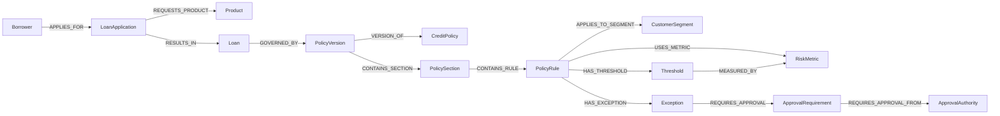

# Credit policy business semantic model

Version **1.2.0**. Design status **CURRENT**. Namespace `urn:cpi:ontology:credit-policy:`.

This package defines the business ontology requested for credit policy knowledge. It is a semantic schema, not a populated production knowledge graph. The supplied example is fictional and cannot establish a policy requirement or approval.

## Machine-readable deliverables

| File | Purpose |
|---|---|
| [semantic-model.json](semantic-model.json) | Class/property dictionary, typed relationships, cardinalities and constraint catalogue |
| [instances.schema.json](instances.schema.json) | JSON Schema 2020-12 for JSON instances |
| [ontology.ttl](ontology.ttl) | OWL/RDFS classes, inheritance, object/data properties and domain/range semantics |
| [shapes.ttl](shapes.ttl) | SHACL Core and SHACL-SPARQL validation constraints |
| [example.json](example.json) | Explicitly illustrative JSON instance, including 80% LTV and exception approval |
| [example.ttl](example.ttl) | The same illustrative instance as RDF, with evidence-bearing assertion reification |
| [validation-report.json](validation-report.json) | Actual schema, Turtle and SHACL validation results |
| [manifest.json](manifest.json) | SHA-256 checksums and package version |

## Reading the model



A threshold stores operator, numeric value and unit. For example, `LTE`, `80`, `%` is at most 80 percent, not equality and not a value of 0.8. The metric declares permitted units. Credit score scales and SME size definitions are not assumed. A policy identity has separately identified versions; rules and exact passages belong to the same version.

Conditions use explicit AND/OR/NOT groups. An exception links to its base rule and may link to an alternative exception rule and an approval requirement. An authority requirement is distinct from an approval decision. Evidence requirements are distinct from actual evidence artifacts.

## Classes

| Class | Parent | Definition | Required data properties |
|---|---|---|---|
| Customer | — | A person or organization with a banking relationship. | — |
| Borrower | Customer | A customer seeking or receiving credit; a specialized Customer. | — |
| LoanApplication | — | A request for credit, distinct from an originated loan. | — |
| Loan | — | An originated credit agreement or facility. | — |
| CreditPolicy | — | A stable policy identity across separately identified versions. | policy_reference |
| PolicyVersion | — | An immutable, source-bound version of a credit policy. | version, source_checksum |
| PolicySection | — | A section of one policy version, optionally nested within another section. | section_reference |
| PolicyRule | — | A source-derived normative requirement within exactly one policy version. | rule_reference, rule_kind |
| Condition | — | A typed comparison used in scope, eligibility or exception logic. | field, operator |
| ConditionGroup | — | An explicit AND, OR or NOT expression over conditions or nested groups. | logic |
| Threshold | — | A numerical boundary with an operator and unit, measured against exactly one metric. | operator, value, unit |
| CustomerSegment | — | A controlled grouping of customers, such as SME; no numerical SME definition is assumed. | segment_code |
| Product | — | A controlled credit product or facility type. | product_code |
| Geography | — | A jurisdiction or geographic grouping used in explicit policy scope. | geography_code, code_scheme |
| RiskMetric | — | A defined quantitative measure with declared permitted units and optional formula. | metric_key, allowed_units |
| Exception | — | A conditional deviation from one base rule. Approval and alternative rules are explicit links. | exception_reference |
| ApprovalRequirement | — | A required decision by an identified authority; this is not an approval already granted. | decision_type |
| ApprovalAuthority | — | An accountable role or committee empowered to make a specified decision. | authority_code, authority_kind |
| EvidenceRequirement | — | A required evidence type and optional freshness condition. | evidence_type |
| ControlEvidence | — | An actual evidence artifact with its recorded verification state. | evidence_reference, evidence_type, verification_state |
| EffectivePeriod | — | An inclusive start date and optional inclusive end date; absent period means unknown validity. | start_date |
| SourcePassage | — | Exact evidence text, source identity, version and checksum; never a generated policy summary. | document_reference, version, source_checksum, text, origin |
| TaxonomyConcept | — | A reference to a controlled classification concept; classification is distinct from executable applicability. | taxonomy_id, taxonomy_version |
| DataAttribute | — | An exact source-system or workbook attribute; bindings require separate governance. | entity_name, attribute_name, registry_reference |

Every entity also carries an IRI, label, status, synthetic flag and source references. SourcePassage can have no source references because it is itself exact evidence.

## Typed relationships

| Relationship | Domain | Range | Per-subject count | Meaning |
|---|---|---|---|---|
| HAS_APPLICABILITY | PolicyVersion | ConditionGroup | 0..1 | Source-backed scope inherited by rules of this policy version. |
| HAS_EXCLUSION | PolicyVersion | ConditionGroup | 0..1 | Source-backed exclusion from a policy version. |
| APPLIES_FOR | Borrower | LoanApplication | 0..* | A borrower submits a credit application. |
| REQUESTS_PRODUCT | LoanApplication | Product | 1..1 | The product requested by an application. |
| RESULTS_IN | LoanApplication | Loan | 0..1 | An application results in an originated loan; absence does not imply rejection. |
| BORROWS | Borrower | Loan | 0..* | A borrower is a party to an originated loan. |
| OF_PRODUCT | Loan | Product | 1..1 | The product type of an originated loan. |
| GOVERNED_BY | Loan | PolicyVersion | 0..* | The exact policy version governing a loan; not inferred merely from product mentions. |
| VERSION_OF | PolicyVersion | CreditPolicy | 1..1 | A policy version belongs to one stable policy identity. |
| CONTAINS_SECTION | PolicyVersion | PolicySection | 0..* | A version contains a section. |
| PART_OF_VERSION | PolicySection or PolicyRule | PolicyVersion | 1..1 | A section or rule belongs to exactly one policy version. |
| PARENT_SECTION | PolicySection | PolicySection | 0..1 | Optional containing section within the same version. |
| CONTAINS_RULE | PolicyVersion or PolicySection | PolicyRule | 0..* | A policy version or section contains a rule. |
| APPLIES_TO_PRODUCT | PolicyRule | Product | 0..* | Explicit applicability to a product, distinct from classification. |
| APPLIES_TO_SEGMENT | PolicyRule | CustomerSegment | 0..* | Explicit applicability to a customer segment. |
| APPLIES_IN | PolicyRule | Geography | 0..* | Explicit geographic scope of a rule. |
| MEMBER_OF_SEGMENT | Customer | CustomerSegment | 0..* | Source-backed customer membership in a segment. |
| USES_METRIC | PolicyRule | RiskMetric | 0..* | A rule uses a defined risk measure. |
| HAS_THRESHOLD | PolicyRule | Threshold | 0..* | A rule has a numerical boundary. |
| MEASURED_BY | Threshold | RiskMetric | 1..1 | The metric against which a threshold is interpreted. |
| HAS_CONDITION | PolicyRule or Exception or ApprovalRequirement | ConditionGroup | 0..1 | The explicit logical condition for a rule, exception or approval requirement. |
| HAS_MEMBER | ConditionGroup | Condition or ConditionGroup | 1..* | A logical expression contains comparison terms or nested expressions. |
| HAS_EXCEPTION | PolicyRule | Exception | 0..* | A rule permits an explicitly stated exception. |
| EXCEPTION_TO | Exception | PolicyRule | 1..1 | The one base rule from which an exception permits deviation. |
| IMPLEMENTED_BY_RULE | Exception | PolicyRule | 0..1 | An optional alternative rule specifies the permitted deviation. |
| REQUIRES_APPROVAL | PolicyRule or Exception | ApprovalRequirement | 0..* | A rule or exception requires a decision, not evidence that it has been granted. |
| REQUIRES_APPROVAL_FROM | ApprovalRequirement | ApprovalAuthority | 1..1 | The role or committee required for an approval decision. |
| REQUIRES_EVIDENCE | PolicyRule or ApprovalRequirement | EvidenceRequirement | 0..* | A rule or approval requires an evidence type. |
| SATISFIES_REQUIREMENT | ControlEvidence | EvidenceRequirement | 0..* | A recorded claim that an evidence artifact satisfies a requirement; verification remains explicit. |
| EVIDENCE_FOR | ControlEvidence | LoanApplication or PolicyRule or Exception | 0..* | An evidence artifact supports an application, rule or exception. |
| HAS_EFFECTIVE_PERIOD | PolicyVersion or PolicyRule or Exception | EffectivePeriod | 0..1 | An explicitly stated validity period; no period implies no known validity. |
| DERIVED_FROM | PolicyRule | SourcePassage | 1..* | A rule is grounded in one or more exact source passages from its own policy version. |
| SOURCE_IN_VERSION | SourcePassage | PolicyVersion | 1..1 | The policy version containing an exact source passage. |
| CLASSIFIED_AS | PolicyRule or Product or CustomerSegment or RiskMetric or Geography | TaxonomyConcept | 0..* | A semantic entity is classified using an external controlled taxonomy. |
| BINDS_TO_ATTRIBUTE | RiskMetric | DataAttribute | 0..* | An explicit proposed or reviewed metric-to-data binding; never inferred from similar labels. |

Counts apply to each subject of the declared domain. Missing optional scope or validity does not establish unrestricted scope or current validity.

## Validation

JSON Schema checks local structure. The Python/API semantic validator additionally checks IDs, endpoint references/types, relationship counts, units, provenance, source versions, condition logic and dates. Use both when consuming JSON; JSON Schema alone cannot resolve arbitrary cross-node IDs.

RDF uses direct business triples plus `cpi:Assertion` / `rdf:Statement` records for per-edge status and source references. Literal arrays other than Condition.value are represented as repeated properties. IN/NOT_IN values use RDF lists. Subclass types are materialized in example RDF.

Validate RDF against shapes.ttl with inference **none** and SHACL-SPARQL support. OWL is a semantic declaration, not closed-world validation. Avoid inference before validation: inferred inverse relationships would lack the required evidence-bearing assertions. JSON transport uniqueness and JSON array structure are additionally enforced by the JSON validator.

```powershell
# From cpi_server/backend
.venv/Scripts/python.exe scripts/export_semantic_model.py
.venv/Scripts/python.exe scripts/export_semantic_model.py --validate outputs/ontology/example.json
```

```python
from rdflib import Graph
from pyshacl import validate
conforms, report, text = validate(
    Graph().parse("example.ttl", format="turtle"),
    shacl_graph=Graph().parse("shapes.ttl", format="turtle"),
    inference="none", advanced=True, meta_shacl=True,
)
```

### Semantic constraints

- **UNIQUE_IDS**: Node and relationship IDs must be unique across the instance.
- **TYPED_ENDPOINTS**: Every relationship endpoint exists and satisfies the declared domain/range, including subclass inheritance.
- **SOURCE_REFERENCES**: Every assertion and every non-passage entity has exact SourcePassage references.
- **SOURCE_VERSION**: A rule and its derived source passages belong to the same policy version; source checksum/version agree.
- **CONTAINMENT**: Section/rule containment and parent-section links agree with PART_OF_VERSION.
- **THRESHOLD_METRIC**: Each threshold has one metric; its unit is permitted by that metric and the owning rule USES_METRIC.
- **QUANTITATIVE_RULE**: A QUANTITATIVE rule has at least one threshold and metric.
- **EXCEPTION_LINKS**: HAS_EXCEPTION and EXCEPTION_TO agree; an implemented alternative has rule_kind EXCEPTION_RULE and shares the base version.
- **CONDITIONS**: IN/NOT_IN use nonempty lists; EXISTS omits value; other comparisons require scalar values; ordered comparisons require numbers.
- **CONDITION_LOGIC**: NOT has exactly one member; AND/OR have at least one; condition groups and section parents are acyclic.
- **EFFECTIVE_DATES**: An end date, when provided, cannot precede the start date.
- **EXAMPLE_ISOLATION**: EXAMPLE instances are synthetic and use illustrative passages; SOURCE_BACKED instances cannot cite illustrative passages.
- **SYNTHETIC_PROVENANCE**: An entity supported by synthetic source passages must itself retain the synthetic flag.

## Integration and governance

- The authenticated API exposes `/api/risk-knowledge/semantic-model`, `/schema`, `/ontology.ttl`, `/shapes.ttl`, `/example`, and POST `/validate` under that prefix.
- `CLASSIFIED_AS` references the taxonomy concept ID and version; classification never establishes rule applicability.
- `BINDS_TO_ATTRIBUTE` is an explicit binding assertion. Similar attribute names are not equivalent by default.
- The existing compiler contract `/policy-ontology` is a separate, narrower executable vocabulary. This package does not change compiler behavior.
- Existing stored ontology relationship labels are not automatically converted, approved or declared equivalent to this contract.
- Validation establishes structural consistency, not factual correctness, authorization or source interpretation. This design remains proposed for business review.
- No existing policy, rule, ontology assertion or taxonomy approval is changed by generating these files.

## Standards references

- [JSON Schema 2020-12](https://json-schema.org/draft/2020-12/json-schema-core)
- [OWL 2](https://www.w3.org/TR/owl2-primer/)
- [SHACL](https://www.w3.org/TR/shacl/)
