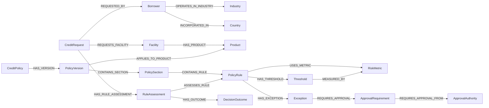

# Credit policy business semantic model

Version **1.4.0**. Design status **CURRENT**. Namespace `urn:cpi:ontology:credit-policy:`.

This package defines the business ontology for credit policy knowledge. The source-backed policy graph is available in the connected knowledge package. The supplied example is fictional and cannot establish a policy requirement or approval.

## Machine-readable deliverables

| File | Purpose |
|---|---|
| [semantic-model.json](semantic-model.json) | Class/property dictionary, typed relationships, cardinalities and constraint catalogue |
| [instances.schema.json](instances.schema.json) | JSON Schema 2020-12 for JSON instances |
| [ontology.ttl](ontology.ttl) | OWL/RDFS classes, inheritance, object/data properties and domain/range semantics |
| [shapes.ttl](shapes.ttl) | SHACL Core and SHACL-SPARQL validation constraints |
| [example.json](example.json) | Explicitly illustrative JSON instance, including 80% LTV and exception approval |
| [example.ttl](example.ttl) | The same illustrative instance as RDF, with evidence-bearing assertion reification |
| [validation-report.json](validation-report.json) | Actual schema, Turtle and SHACL validation results |
| [manifest.json](manifest.json) | SHA-256 checksums and package version |

## Reading the model

- **Domain**. Deals, parties, geography, economic classifications, facilities and risk.
- **Policy**. Versioned source evidence, taxonomy, rules, thresholds, exceptions and approvals.
- **Applicability**. Policy scope and rule conditions connected to domain values and deal attributes.
- **Decision**. Request-specific rule evaluations and recorded outcomes.



A threshold stores operator, numeric value and unit. For example, `LTE`, `80`, `%` is at most 80 percent, not equality and not a value of 0.8. The metric declares permitted units. Credit score scales and SME size definitions are not assumed. A policy identity has separately identified versions; rules and exact passages belong to the same version.

Conditions use explicit AND/OR/NOT groups. An exception links to its base rule and may link to an alternative exception rule and an approval requirement. An authority requirement is distinct from an approval decision. Evidence requirements are distinct from actual evidence artifacts.

## Classes

| Class | Parent | Definition | Required data properties |
|---|---|---|---|
| Customer | Party | A person or organization with a banking relationship. | — |
| Borrower | Customer | A customer seeking or receiving credit; a specialized Customer. | — |
| LoanApplication | CreditRequest | A request for credit, distinct from an originated loan. | — |
| Loan | Facility | An originated credit agreement or facility. | — |
| CreditPolicy | — | A stable policy identity across separately identified versions. | policy_reference |
| PolicyVersion | — | An immutable, source-bound version of a credit policy. | version, source_checksum |
| PolicySection | — | A section of one policy version, optionally nested within another section. | section_reference |
| PolicyRule | — | A source-derived normative requirement within exactly one policy version. | rule_reference, rule_kind |
| Condition | — | A typed comparison used in scope, eligibility or exception logic. | field, operator |
| ConditionGroup | — | An explicit AND, OR or NOT expression over conditions or nested groups. | logic |
| Threshold | — | A numerical boundary with an operator and unit, measured against exactly one metric. | operator, value, unit |
| CustomerSegment | — | A controlled grouping of customers, such as SME; no numerical SME definition is assumed. | segment_code |
| Product | — | A controlled credit product or facility type. | product_code |
| Geography | — | A jurisdiction or geographic grouping used in explicit policy scope. | geography_code, code_scheme |
| RiskMetric | RiskAttribute | A defined quantitative measure with declared permitted units and optional formula. | metric_key, allowed_units |
| Exception | — | A conditional deviation from one base rule. Approval and alternative rules are explicit links. | exception_reference |
| ApprovalRequirement | — | A required decision by an identified authority; this is not an approval already granted. | decision_type |
| ApprovalAuthority | — | An accountable role or committee empowered to make a specified decision. | authority_code, authority_kind |
| EvidenceRequirement | — | A required evidence type and optional freshness condition. | evidence_type |
| ControlEvidence | — | An actual evidence artifact with its recorded verification state. | evidence_reference, evidence_type, verification_state |
| EffectivePeriod | — | An inclusive start date and optional inclusive end date; absent period means unknown validity. | start_date |
| SourcePassage | — | Exact evidence text, source identity, version and checksum; never a generated policy summary. | document_reference, version, source_checksum, text, origin |
| TaxonomyConcept | — | A reference to a controlled classification concept; classification is distinct from executable applicability. | taxonomy_id, taxonomy_version |
| DataAttribute | — | An exact source-system or workbook attribute; bindings require separate governance. | entity_name, attribute_name, registry_reference |
| Party | — | A person, organization, or group with a role in a credit relationship. | — |
| LegalEntity | Party | An independently constituted organization that can be a parent entity. | — |
| Counterparty | Party | A party on the other side of a credit transaction. | — |
| Guarantor | Party | A party that provides a guarantee. | — |
| Sponsor | Party | A party that supports a borrower or a financed transaction. | — |
| Lender | Party | A party providing credit. | — |
| Tenant | Party | A party leasing financed or pledged property. | — |
| CorporateGroup | Party | A group of affiliated parties. | — |
| CreditRequest | — | A request for one or more credit facilities. | — |
| Facility | — | A requested or committed credit arrangement. | — |
| Country | Geography | A country identified under an explicit geographic code scheme. | — |
| Jurisdiction | Geography | A territory under a particular legal or regulatory authority. | — |
| Region | Geography | A geographic grouping of territories. | — |
| BookingLocation | — | The office or location where a facility is booked. | — |
| Industry | — | An economic classification of a party or financed activity. | — |
| Sector | — | A broad economic classification. | — |
| Subsector | — | A finer economic classification within a sector. | — |
| BusinessActivity | — | An economic activity conducted by a party or financed by a facility. | — |
| BorrowerType | — | A classification used for borrower eligibility. | — |
| Exposure | — | A credit exposure measured at the applicable entity and reporting scope. | — |
| Limit | — | An authorized exposure ceiling. | — |
| Collateral | — | An asset or security pledged against credit. | — |
| Guarantee | — | A commitment by a guarantor to support an obligation. | — |
| Tenor | — | The duration of a facility in months. | months |
| Currency | — | The currency in which a credit amount is denominated. | currency_code |
| Purpose | — | The stated intended use of funding. | — |
| RiskAttribute | — | A qualitative or quantitative characteristic used in credit-risk analysis. | — |
| CreditRating | RiskAttribute | An observed credit rating under an identified rating type. | rating_code, rating_type |
| RiskGrade | RiskAttribute | A grade assigned under a risk classification scale. | — |
| RiskObservation | — | An observed deal risk value with the unit supplied by its source. | risk_key, observed_value |
| PolicyClass | TaxonomyConcept | A policy category or topic in the current policy taxonomy. | — |
| PolicyConcern | — | A source-backed subject or dependency used to navigate rules. | concern_code |
| IndustryTier | — | A risk tier assigned to an industry under the relevant classification. | — |
| OperationalEvidence | — | A source reference for a deal fact or an assessment output. | source_type, source_reference |
| RuleAssessment | — | An evaluation of a specific credit request against a specific policy rule. | evaluated_on |
| DecisionOutcome | — | The recorded result of a rule assessment. | outcome_code |

Every entity also carries an IRI, label, status, synthetic flag and source references. SourcePassage and OperationalEvidence can be referenced directly as evidence.

## Typed relationships

| Relationship | Domain | Range | Per-subject count | Meaning |
|---|---|---|---|---|
| HAS_APPLICABILITY | PolicyVersion | ConditionGroup | 0..1 | Source-backed scope inherited by rules of this policy version. |
| HAS_EXCLUSION | PolicyVersion | ConditionGroup | 0..1 | Source-backed exclusion from a policy version. |
| APPLIES_FOR | Borrower | LoanApplication | 0..* | A borrower submits a credit application. |
| REQUESTS_PRODUCT | LoanApplication | Product | 1..1 | The product requested by an application. |
| RESULTS_IN | LoanApplication | Loan | 0..1 | An application results in an originated loan; absence does not imply rejection. |
| BORROWS | Borrower | Loan | 0..* | A borrower is a party to an originated loan. |
| OF_PRODUCT | Loan | Product | 1..1 | The product type of an originated loan. |
| GOVERNED_BY | Loan | PolicyVersion | 0..* | The exact policy version governing a loan; not inferred merely from product mentions. |
| VERSION_OF | PolicyVersion | CreditPolicy | 1..1 | A policy version belongs to one stable policy identity. |
| CONTAINS_SECTION | PolicyVersion | PolicySection | 0..* | A version contains a section. |
| PART_OF_VERSION | PolicySection or PolicyRule | PolicyVersion | 1..1 | A section or rule belongs to exactly one policy version. |
| PARENT_SECTION | PolicySection | PolicySection | 0..1 | Optional containing section within the same version. |
| CONTAINS_RULE | PolicyVersion or PolicySection | PolicyRule | 0..* | A policy version or section contains a rule. |
| APPLIES_TO_PRODUCT | PolicyVersion or PolicyRule | Product | 0..* | Explicit applicability to a product. |
| APPLIES_TO_SEGMENT | PolicyVersion or PolicyRule | CustomerSegment | 0..* | Explicit applicability to a customer segment. |
| APPLIES_IN | PolicyVersion or PolicyRule | Geography | 0..* | Explicit geographic scope, including jurisdiction when identified as such. |
| MEMBER_OF_SEGMENT | Customer | CustomerSegment | 0..* | Source-backed customer membership in a segment. |
| USES_METRIC | PolicyRule | RiskMetric | 0..* | A rule uses a defined risk measure. |
| HAS_THRESHOLD | PolicyRule | Threshold | 0..* | A rule has a numerical boundary. |
| MEASURED_BY | Threshold | RiskMetric | 1..1 | The metric against which a threshold is interpreted. |
| HAS_CONDITION | PolicyRule or Exception or ApprovalRequirement | ConditionGroup | 0..1 | The explicit logical condition for a rule, exception or approval requirement. |
| HAS_MEMBER | ConditionGroup | Condition or ConditionGroup | 1..* | A logical expression contains comparison terms or nested expressions. |
| HAS_EXCEPTION | PolicyRule | Exception | 0..* | A rule permits an explicitly stated exception. |
| EXCEPTION_TO | Exception | PolicyRule | 1..1 | The one base rule from which an exception permits deviation. |
| IMPLEMENTED_BY_RULE | Exception | PolicyRule | 0..1 | An optional alternative rule specifies the permitted deviation. |
| REQUIRES_APPROVAL | PolicyRule or Exception | ApprovalRequirement | 0..* | A rule or exception requires a decision, not evidence that it has been granted. |
| REQUIRES_APPROVAL_FROM | ApprovalRequirement | ApprovalAuthority | 1..1 | The role or committee required for an approval decision. |
| REQUIRES_EVIDENCE | PolicyRule or ApprovalRequirement | EvidenceRequirement | 0..* | A rule or approval requires an evidence type. |
| SATISFIES_REQUIREMENT | ControlEvidence | EvidenceRequirement | 0..* | A recorded claim that an evidence artifact satisfies a requirement; verification remains explicit. |
| EVIDENCE_FOR | ControlEvidence | LoanApplication or PolicyRule or Exception | 0..* | An evidence artifact supports an application, rule or exception. |
| HAS_EFFECTIVE_PERIOD | PolicyVersion or PolicyRule or Exception | EffectivePeriod | 0..1 | An explicitly stated validity period; no period implies no known validity. |
| DERIVED_FROM | PolicyRule | SourcePassage | 1..* | A rule is grounded in one or more exact source passages from its own policy version. |
| SOURCE_IN_VERSION | SourcePassage | PolicyVersion | 1..1 | The policy version containing an exact source passage. |
| CLASSIFIED_AS | PolicyRule or Product or CustomerSegment or RiskMetric or Geography | TaxonomyConcept | 0..* | A semantic entity is classified using an external controlled taxonomy. |
| BINDS_TO_ATTRIBUTE | RiskMetric | DataAttribute | 0..* | An explicit proposed or reviewed metric-to-data binding; never inferred from similar labels. |
| OPERATES_IN_INDUSTRY | Party | Industry | 0..* | The industry in which the party operates. |
| OPERATES_IN_GEOGRAPHY | Party | Geography | 0..* | A geography explicitly identified as a location of operations. |
| HAS_REPORTED_GEOGRAPHY | Party | Geography | 0..* | Geography reported without a specific legal, booking, or risk role. |
| INCORPORATED_IN | Party | Country | 0..* | The country of legal incorporation. |
| DOMICILED_IN | Party | Country | 0..* | The country of domicile as reported by the source. |
| HAS_COUNTRY_OF_RISK | Party or Facility or Exposure | Country | 0..* | The country attributed to the party, facility, or exposure for credit-risk analysis. |
| IN_REGION | Geography | Region | 0..* | The geography belongs to a geographic region. |
| BELONGS_TO_GROUP | Party | CorporateGroup | 0..* | The party is a member of a corporate group. |
| HAS_PARENT_LEGAL_ENTITY | Party | LegalEntity | 0..* | The identified parent organization of a party. |
| IN_SECTOR | Party or Industry or Subsector | Sector | 0..* | The party or economic classification belongs to a sector. |
| IN_SUBSECTOR | Party or BusinessActivity | Subsector | 0..* | The party or activity is classified in a subsector. |
| HAS_BUSINESS_ACTIVITY | Party or Facility | BusinessActivity | 0..* | The activity attributed to a party or financed by a facility. |
| HAS_BORROWER_TYPE | Borrower | BorrowerType | 0..* | The explicitly reported borrower classification. |
| HAS_CREDIT_RATING | Party | CreditRating | 0..* | A rating attributed to the party. |
| HAS_RISK_GRADE | Party or Facility | RiskGrade | 0..* | A grade attributed to the party or facility. |
| HAS_RISK_ATTRIBUTE | Party or Facility or Exposure or CreditRequest | RiskAttribute | 0..* | A risk measure or characteristic, such as PD, LGD, LTV, concentration, country risk or industry risk. |
| HAS_RISK_OBSERVATION | Party or Facility or Exposure or CreditRequest | RiskObservation | 0..* | A measured risk value recorded in the request context. |
| HAS_EXPOSURE | Party or Facility | Exposure | 0..* | An exposure attributed to the party or facility. |
| SUBJECT_TO_LIMIT | Exposure or Facility | Limit | 0..* | A documented ceiling covering the exposure or facility. |
| REQUESTED_BY | CreditRequest | Borrower | 0..* | The borrower seeking credit. |
| REQUESTS_FACILITY | CreditRequest | Facility | 0..* | A facility the borrower asks the lender to provide. |
| HAS_PRODUCT | Facility | Product | 0..* | The product used to structure a requested or originated facility. |
| HAS_COUNTERPARTY | Facility | Counterparty | 0..* | A counterparty to the facility. |
| HAS_SPONSOR | CreditRequest or Facility | Sponsor | 0..* | A sponsor for the request or the facility. |
| HAS_LENDER | Facility | Lender | 0..* | A lender providing the facility. |
| HAS_TENOR | Facility | Tenor | 0..1 | The requested or contractual facility duration. |
| HAS_RECOMMENDED_TENOR | Facility | Tenor | 0..1 | A recommended facility duration recorded by the credit system. |
| HAS_TENANT | Facility or Collateral | Tenant | 0..* | A tenant of property financed or pledged to the facility. |
| HAS_COLLATERAL | Facility | Collateral | 0..* | Collateral pledged for the facility. |
| HAS_GUARANTEE | Facility | Guarantee | 0..* | A guarantee supporting the facility. |
| PROVIDED_BY_GUARANTOR | Guarantee | Guarantor | 0..* | The party providing the guarantee. |
| BOOKED_IN_JURISDICTION | Facility | Jurisdiction | 0..* | The jurisdiction in which the facility is booked. |
| BOOKED_AT | Facility | BookingLocation | 0..* | The booking office or location for the facility. |
| LOCATED_IN_JURISDICTION | BookingLocation | Jurisdiction | 0..* | The jurisdiction of the booking location. |
| DENOMINATED_IN | CreditRequest or Facility or Exposure or Limit | Currency | 0..* | The recorded currency of the credit amount. |
| HAS_PURPOSE | CreditRequest or Facility | Purpose | 0..* | The stated purpose of the request or facility. |
| HAS_VERSION | CreditPolicy | PolicyVersion | 0..* | The stable policy identity has an explicitly identified version. |
| DERIVED_FROM_POLICY_CLASS | PolicyRule | PolicyClass | 0..* | An explicit derivation from a policy class. Classification alone does not establish derivation. |
| CONCERNS | PolicyRule | PolicyConcern | 0..* | A source-backed rule subject or dependency. |
| REQUIRES_APPROVAL_ON_BREACH | PolicyRule | ApprovalRequirement | 0..* | The cited approval or escalation is explicitly triggered by a threshold breach. |
| REQUIRES_APPROVAL_ABOVE_THRESHOLD | PolicyRule | ApprovalRequirement | 0..* | The cited approval or escalation applies above an authority or transaction threshold. |
| APPLIES_TO_INDUSTRY | PolicyVersion or PolicyRule | Industry | 0..* | An industry explicitly required by policy or rule scope. Full scope follows the condition logic. |
| APPLIES_TO_BORROWER_TYPE | PolicyVersion or PolicyRule | BorrowerType | 0..* | An explicit borrower type in policy or rule scope. |
| APPLIES_TO_SUBSECTOR | PolicyVersion or PolicyRule | Subsector | 0..* | An expressly included economic or property subsector. Full scope follows the policy and rule conditions. |
| APPLIES_TO_INDUSTRY_TIER | PolicyVersion or PolicyRule | IndustryTier | 0..* | An explicitly included industry risk tier. |
| DOCUMENTS_PRODUCT_SCOPE | PolicyRule | Product | 0..* | A rule statement identifies this product. Other eligibility conditions remain in the source. |
| COMPARES_SCOPE_VALUE | Condition | Industry or Sector or Subsector or IndustryTier or BorrowerType or Product or CustomerSegment or Geography | 0..* | A typed value tested by a condition. The operator and its parent group determine how the comparison is used. |
| EVALUATES_RISK_ATTRIBUTE | PolicyRule | RiskAttribute | 0..* | The rule checks a quantitative measure or qualitative risk characteristic. |
| TESTS_ATTRIBUTE | Condition | DataAttribute | 0..* | A condition names a field with an explicit binding in the deal fact registry. |
| OBSERVES_DATA_ATTRIBUTE | RiskObservation | DataAttribute | 0..1 | The observation is sourced from a registered deal attribute. |
| HAS_RULE_ASSESSMENT | CreditRequest | RuleAssessment | 0..* | The credit request has a recorded rule evaluation. |
| ASSESSES_RULE | RuleAssessment | PolicyRule | 1..1 | The exact rule checked in this evaluation. |
| HAS_OUTCOME | RuleAssessment | DecisionOutcome | 1..1 | The result produced by this request-specific rule evaluation. |

Counts apply to each subject of the declared domain. Missing optional scope or validity does not establish unrestricted scope or current validity.

## Validation

JSON Schema checks local structure. The Python/API semantic validator additionally checks IDs, endpoint references/types, relationship counts, units, provenance, source versions, condition logic and dates. Use both when consuming JSON; JSON Schema alone cannot resolve arbitrary cross-node IDs.

RDF uses direct business triples plus `cpi:Assertion` / `rdf:Statement` records for per-edge status and source references. Literal arrays other than Condition.value are represented as repeated properties. IN/NOT_IN values use RDF lists. Subclass types are materialized in example RDF.

Validate RDF against shapes.ttl with inference **none** and SHACL-SPARQL support. OWL is a semantic declaration, not closed-world validation. Avoid inference before validation: inferred inverse relationships would lack the required evidence-bearing assertions. JSON transport uniqueness and JSON array structure are additionally enforced by the JSON validator.

```powershell
# From cpi_server/backend
.venv/Scripts/python.exe scripts/export_semantic_model.py
.venv/Scripts/python.exe scripts/export_semantic_model.py --validate outputs/ontology/example.json
```

```python
from rdflib import Graph
from pyshacl import validate
conforms, report, text = validate(
    Graph().parse("example.ttl", format="turtle"),
    shacl_graph=Graph().parse("shapes.ttl", format="turtle"),
    inference="none", advanced=True, meta_shacl=True,
)
```

### Semantic constraints

- **UNIQUE_IDS**: Node and relationship IDs must be unique across the instance.
- **TYPED_ENDPOINTS**: Every relationship endpoint exists and satisfies the declared domain/range, including subclass inheritance.
- **SOURCE_REFERENCES**: Every assertion and non-evidence entity references policy passages or operational evidence. Rules retain their exact source passages.
- **SOURCE_VERSION**: A rule and its derived source passages belong to the same policy version; source checksum/version agree.
- **CONTAINMENT**: Section/rule containment and parent-section links agree with PART_OF_VERSION.
- **THRESHOLD_METRIC**: Each threshold has one metric; its unit is permitted by that metric and the owning rule USES_METRIC.
- **QUANTITATIVE_RULE**: A QUANTITATIVE rule has at least one threshold and metric.
- **EXCEPTION_LINKS**: HAS_EXCEPTION and EXCEPTION_TO agree; an implemented alternative has rule_kind EXCEPTION_RULE and shares the base version.
- **CONDITIONS**: Membership uses a nonempty list. EXISTS omits its value. Ordered comparisons use numbers or recognized credit rating codes.
- **CONDITION_LOGIC**: NOT has exactly one member; AND/OR have at least one; condition groups and section parents are acyclic.
- **EFFECTIVE_DATES**: An end date, when provided, cannot precede the start date.
- **EXAMPLE_ISOLATION**: EXAMPLE instances are synthetic and use illustrative passages; SOURCE_BACKED instances cannot cite illustrative passages.
- **SYNTHETIC_PROVENANCE**: An entity supported by synthetic source passages must itself retain the synthetic flag.

## Integration and governance

- The authenticated API exposes `/api/risk-knowledge/semantic-model`, `/schema`, `/ontology.ttl`, `/shapes.ttl`, `/example`, and POST `/validate` under that prefix.
- `CLASSIFIED_AS` references the taxonomy concept ID and version; classification never establishes rule applicability.
- `BINDS_TO_ATTRIBUTE` is an explicit binding assertion. Similar attribute names are not equivalent by default.
- The executable policy compiler reads its vocabulary from `app/risk_knowledge/policy_ontology.py`. The API route `/policy-ontology` returns this business semantic contract.
- Existing stored ontology relationship labels are not automatically converted, approved or declared equivalent to this contract.
- Validation checks structure and evidence references. Approvals require a recorded decision.
- No existing policy, rule, ontology assertion or taxonomy approval is changed by generating these files.

## Standards references

- [JSON Schema 2020-12](https://json-schema.org/draft/2020-12/json-schema-core)
- [OWL 2](https://www.w3.org/TR/owl2-primer/)
- [SHACL](https://www.w3.org/TR/shacl/)
